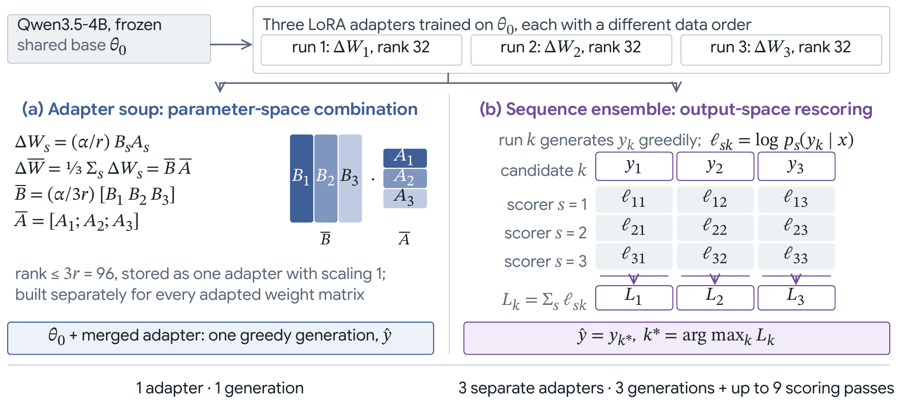

# VLSP 2026 Numerical Reasoning QA

Given a Vietnamese financial report with text, HTML tables and chart images, this system writes the
reasoning program that answers a question about it.

## Example

A made-up report contains this chart as `Image 1`:


Question: *Doanh thu năm 2024 tăng bao nhiêu phần trăm so với năm 2023?*
(By what percentage did revenue grow from 2023 to 2024?)

Qwen3-VL-8B turns the chart into a label card:

```json
{"title": "Kết quả kinh doanh 2021-2024", "series_labels": ["Doanh thu", "Lợi nhuận sau thuế"], "x_axis_labels": ["2021", "2022", "2023", "2024"]}
```

The writer reads the card, the report text and tables, and 10 similar question/program pairs from other
reports, then writes:

```text
chart_at(Image 1; Doanh thu; 2023; none); chart_at(Image 1; Doanh thu; 2024; none);
subtract(#1; #0); divide(#2; #0); multiply(#3; 100)
```

`#k` is the result of step k. The program selects chart cells by label, so the card carries labels only.

## Method

BM25 over question text picks the 10 examples. Qwen3.5-4B is fine-tuned with NF4 QLoRA on the program
tokens, and three runs that differ only in data order are averaged into one adapter:



## Quickstart

Request the data from VLSP through the
[task page](https://vlsp.org.vn/vlsp2026/eval/vitnumchart) and place it as follows:

```text
VLSP/train.json  VLSP/train_images/
public_test.json  public_test_images/
private_test.json  private_test_images/
```

```sh
./run_final.sh private    # writes runs/soup/sft_x3nf4_r32/fold_all/private_hf/results.zip
```

Use `./run_final.sh public` for the public split. `./run_final.sh private 2` trains on two copies of the
training set instead of three.

## Stages

```sh
.venv-vllm/bin/python -m src.charts train|public|private        # chart cards
python -m src.main FOLD SEED [REPEATS]                           # train one seed, and score it if FOLD is 0-4
python -m src.reasoning.soup sft_x3nf4_r32 FOLD                  # average seeds 0-2
python -m src.reasoning.predict FOLD|public|private RUN_DIR      # greedy decoding and results.zip
python -m src.reasoning.seq_ensemble public|private sft_x2nf4_r32
```

`seq_ensemble` is the alternative to the soup. Each seed scores the three seeds' greedy programs, and the
program with the highest summed log-probability wins.

Decode NF4-trained adapters on the NF4 base. If `.env` exists (see
`.env.example`), each finished run is uploaded to a private Hugging Face repo.

## Code

```text
src/data.py                     loading, program parser, document-grouped folds
src/charts.py                   chart cards (vLLM)
src/main.py                     training entry point
src/reasoning/prompts.py        BM25 examples, prompt, chat template, response parsing
src/reasoning/program.py        Program Accuracy scorer
src/reasoning/writer.py         training, loading, decoding
src/reasoning/soup.py           seed averaging
src/reasoning/predict.py        prediction and submission zip
src/reasoning/seq_ensemble.py   sequence ensemble
```
