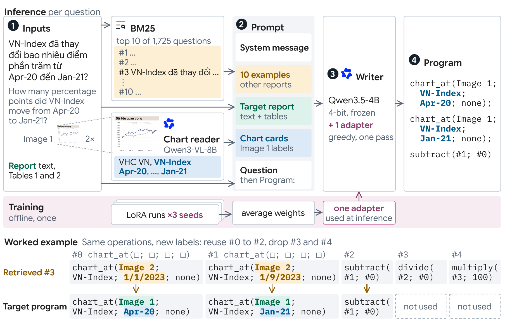

# VLSP 2026 Numerical Reasoning QA

Team Arcane's system for the VLSP 2026 shared task on multimodal numerical reasoning over Vietnamese
financial reports. Given a report with text, HTML tables and chart images, the system writes the
reasoning program that answers a question about it. It ranked **second** on the private leaderboard.

- Paper: [Retrieval-Augmented Fine-Tuning for Vietnamese Multimodal Numerical Reasoning](paper/main.pdf)
- Submitted adapter: [lducc/vlsp2026-arcane-writer](https://huggingface.co/lducc/vlsp2026-arcane-writer) on Hugging Face
- Chart cards: [lducc/vlsp2026-chart-cards](https://huggingface.co/datasets/lducc/vlsp2026-chart-cards) on Hugging Face
- Task page: [VLSP 2026 Numerical Reasoning QA](https://vlsp.org.vn/vlsp2026/eval/vitnumchart)

## Results

The official metric is Program Accuracy (PA), which compares the predicted program with the reference.
Execution Accuracy (EA) only checks the computed answer.

Official private leaderboard, top six:

| Team | Rank | PA | EA |
|---|---:|---:|---:|
| thanhducsvbg | 1 | 79.17 | 89.33 |
| **Arcane (ours)** | **2** | **78.66** | **87.61** |
| Taekz | 3 | 76.42 | 87.44 |
| bachanglinhngulam | 4 | 74.35 | 86.92 |
| rudeus | 5 | 73.32 | 85.71 |
| HUNTER | 6 | 72.46 | 83.30 |

Our system variants:

| Combination | Epochs | Writer passes | Private PA | Private EA |
|---|---:|---:|---:|---:|
| Adapter soup (submitted) | 3 | 1 | 78.66 | 87.61 |
| Adapter soup | 2 | 1 | 77.45 | 88.47 |
| Sequence ensemble | 2 | 3 | 77.28 | 88.30 |

On held-out training reports, fine-tuning raises PA from 45.6 (base Qwen3.5-4B with the same ten BM25
examples) to 73.0, and BM25 examples beat random ones by 3.7 points.

## Overview



- Inference (per question): BM25 retrieves ten solved questions from other reports. Qwen3-VL-8B
  reads each chart, enlarged 2×, into a chart card of its labels. The examples, the report, the cards and
  the question fill one prompt, and the fine-tuned Qwen3.5-4B writer outputs the program in one greedy pass.
- Training (offline, once): Three LoRA runs that differ only in data order are averaged into one
  adapter, which the writer uses at inference.
- Worked example: The target reuses the first three steps of a retrieved example with its own chart
  labels.

## Example

The training question below asks about `Image 1` of a report on VHC:


> **Question:** VN-Index đã thay đổi bao nhiêu điểm phần trăm từ Apr-20 đến Jan-21?
> (How many percentage points did VN-Index move from Apr-20 to Jan-21?)

**1. Chart card.** Qwen3-VL-8B lists the chart's labels. Programs select chart values by label, so the
card holds labels only:

```json
{"title": "Dữ liệu quan trọng", "series_labels": ["VHC VN", "VN-Index"], "x_axis_labels": ["Apr-20", "Jul-20", "Oct-20", "Jan-21"]}
```

**2. Retrieved example.** BM25's third result, from another report, asks for a percentage change:

```text
Question: VN-Index đã thay đổi bao nhiêu phần trăm từ 1/1/2023 đến 1/9/2023?
Program:  chart_at(Image 2; VN-Index; 1/1/2023; none); chart_at(Image 2; VN-Index; 1/9/2023; none);
          subtract(#1; #0); divide(#2; #0); multiply(#3; 100)
```

**3. Program.** The writer keeps the first three steps, swaps in `Image 1` and the card's dates, and drops
the division and the ×100, since the question asks for percentage points:

```text
chart_at(Image 1; VN-Index; Apr-20; none); chart_at(Image 1; VN-Index; Jan-21; none); subtract(#1; #0)
```

`#k` is the result of step k.

## Method

| Part | Choice |
|---|---|
| Retrieval | BM25 over question text, top 10 from other reports |
| Chart reader | Qwen3-VL-8B-Instruct, chart enlarged 2× (Lanczos), greedy |
| Writer | Qwen3.5-4B, 4-bit NF4, LoRA rank 32 (α 64), loss on program tokens, 3 epochs |
| Combination | Adapter soup: mean of three runs' updates, stored as one rank-96 adapter |

The adapter soup and the sequence ensemble we compared it with:


## Reproduce

Request the data from VLSP through the [task page](https://vlsp.org.vn/vlsp2026/eval/vitnumchart) and
place it as follows:

```text
VLSP/train.json  VLSP/train_images/
public_test.json  public_test_images/
private_test.json  private_test_images/
```

### Reproduce the submitted private result

This path uses the published adapter and chart cards and needs one GPU with 40 GB (we used an A100
40 GB on Colab). It reads `VLSP/train.json` and `private_test.json`, and none of the images.

```sh
git clone https://github.com/lducc/vlsp && cd vlsp
bash install_unsloth.sh   # inside a virtualenv; on Colab set UV_SYSTEM_PYTHON=1 first
hf download lducc/vlsp2026-chart-cards private_cards.jsonl --repo-type dataset --local-dir cards
mkdir -p runs/charts && cp cards/private_cards.jsonl runs/charts/private_8bz.jsonl
hf download lducc/vlsp2026-arcane-writer --local-dir runs/arcane/final_adapter
python -m src.reasoning.predict private runs/arcane   # writes runs/arcane/private_hf/results.zip
```

The adapter is the mean of the three seed runs. `python -m src.reasoning.soup sft_x3nf4_r32 all` rebuilds
it after training, from `runs/sft_x3nf4_r32/seed{0,1,2}/fold_all/final_adapter`, and our rebuild was bitwise identical
to the published file. For the public split, use `public_cards.jsonl`, `runs/charts/public_8bz.jsonl`
and `predict public`.

### Train from scratch

Run the full pipeline:

```sh
./run_final.sh private    # writes runs/soup/sft_x3nf4_r32/fold_all/private_hf/results.zip
```

Use `./run_final.sh public` for the public split. `./run_final.sh private 2` trains for two epochs
instead of three.

Or run the stages one by one:

```sh
.venv-vllm/bin/python -m src.charts train|public|private        # chart cards
python -m src.main FOLD SEED [REPEATS]                           # train one seed, and score it if FOLD is 0-4
python -m src.reasoning.soup sft_x3nf4_r32 FOLD                  # average seeds 0-2
python -m src.reasoning.predict FOLD|public|private RUN_DIR      # greedy decoding and results.zip
python -m src.reasoning.seq_ensemble public|private sft_x2nf4_r32
```

Decode NF4-trained adapters on the NF4 base. If `.env` exists (see `.env.example`), each finished run is
uploaded to a private Hugging Face repo. The chart cards we used are on
[Hugging Face](https://huggingface.co/datasets/lducc/vlsp2026-chart-cards), so `src.charts` can be skipped.

## Code

```text
src/data.py                     loading, program parser, document-grouped folds
src/charts.py                   chart cards (vLLM)
src/main.py                     training entry point
src/reasoning/prompts.py        BM25 examples, prompt, chat template, response parsing
src/reasoning/program.py        Program Accuracy scorer
src/reasoning/writer.py         training, loading, decoding
src/reasoning/soup.py           seed averaging
src/reasoning/predict.py        prediction and submission zip
src/reasoning/seq_ensemble.py   sequence ensemble
```

## Citation

```bibtex
@misc{arcane2026vlsp,
  title  = {Retrieval-Augmented Fine-Tuning for Vietnamese Multimodal Numerical Reasoning},
  author = {Le, Anh Duc and Pham, Duc Cong and Nguyen, Huu Thanh},
  year   = {2026},
  note   = {System paper, VLSP 2026 shared task on Numerical Reasoning QA},
  url    = {https://github.com/lducc/vlsp}
}

@misc{arcane2026chartcards,
  title  = {Chart cards for the {VLSP} 2026 Numerical Reasoning {QA} shared task},
  author = {Le, Anh Duc and Pham, Duc Cong and Nguyen, Huu Thanh},
  year   = {2026},
  url    = {https://huggingface.co/datasets/lducc/vlsp2026-chart-cards}
}
```
